<div align="center">



[](https://github.com/Thegreatprabh/argus)

[](LICENSE)
[](pyproject.toml)
[](argus/mcp_server.py)
[](docs/TERMUX.md)
[](#-engines)

</div>

```console
$ pip install git+https://github.com/Thegreatprabh/argus
$ argus scan-web https://example.com --deep
$ argus rebuild https://example.com -o ./my-version --project myapp
$ argus dashboard        # 👁️ visual investigation board
$ argus setup            # connect Claude Code, Codex, Cursor, Gemini in one shot
```



---

## 👁️ What is ARGUS?

**Point it at any website or app. Get the full functional blueprint — with evidence.
Then rebuild it as your own, with your AI agent.**

REA (290k⭐ viral) taught agents to *understand* software. ARGUS goes one step
further: **understand → rebuild**. Every finding carries its evidence. Every
rebuild starts from clean, original code *you* own.


## 📦 Installation

**Linux / macOS**
```bash
pip install git+https://github.com/Thegreatprabh/argus
```

**Termux (Android)**
```bash
pkg install python radare2 binwalk
pip install git+https://github.com/Thegreatprabh/argus
```

**From source**
```bash
git clone https://github.com/Thegreatprabh/argus
cd argus
pip install -e .
```

**Verify**
```bash
argus tools     # list all 6 MCP tools
argus --version
```


## ⚔️ ARGUS vs REA — honest table

| | REA | ARGUS |
|---|---|---|
| MCP for AI agents | ✅ | ✅ |
| CLI | ✅ | ✅ |
| Web / JS analysis | ✅ (thin) | ✅ **deep** — tech, APIs, trackers, forms |
| APK analysis | ✅ | ✅ |
| Binary analysis | Ghidra/Hopper/IDA | ✅ **radare2** (free, Termux-ready) |
| Firmware (Binwalk) | ✅ | ✅ |
| **Dynamic analysis (Frida)** | ❌ | ✅ — see what code *does* at runtime |
| **Rebuild scaffold** | ❌ | ✅ — blueprint → starter codebase |
| **Web dashboard UI** | ❌ CLI only | ✅ visual investigation board |
| **Termux / phone** | ❌ desktop-only | ✅ runs in your pocket |
| License | MIT | MIT |

## 🧰 Engines

| Engine | Target | Backend | Command |
|---|---|---|---|
| 🌐 `web.analyze` | Websites | pure Python | `argus scan-web URL --deep` |
| 📦 `apk.overview` | Android APKs | zip-parse / apktool | `argus apk app.apk` |
| ⚙️ `binary.info` | Executables | radare2 | `argus binary prog.exe` |
| 🔍 `firmware.scan` | Firmware blobs | Binwalk | `argus firmware fw.bin` |
| 🔬 `frida.ps` | Running apps | Frida | `argus ps` |
| 🏗️ `rebuild.scaffold` | URL / APK → code | ARGUS core | `argus rebuild TARGET -o ./out` |

## 🤖 Connect your AI agent

```bash
argus setup --dry-run   # preview what changes
argus setup             # Claude Code + Cursor + Codex + Gemini, one shot
```

Or manually: [`./.mcp.json`](.mcp.json)

Then just ask your agent: *"Use ARGUS to map how this app's login works —
and scaffold my own version."* See [`examples/agent-rebuild-session.md`](examples/agent-rebuild-session.md).

Agent playbooks live in [`argus/workflows/`](argus/workflows/):
`trace-feature` · `map-api-surface` · `patch-diff`

## 📱 Termux

```bash
pkg install python radare2 binwalk
pip install git+https://github.com/Thegreatprabh/argus
argus scan-web https://example.com
```

Full guide: [`docs/TERMUX.md`](docs/TERMUX.md). Ghidra can't run on a phone —
ARGUS's radare2-first design can. That's the point.

## 🖥️ Dashboard

```bash
argus dashboard
```

Opens a dark investigation board at `http://localhost:8765` — scan targets,
browse findings, follow the evidence. Zero dependencies.

## 🧠 How it works

```
 target ──▶ engines ──▶ evidence-backed findings ──▶ agent ──▶ rebuild scaffold
 (url/apk/   (web/apk/binary/   (every claim cited)   (MCP/CLI/      (your own
  binary/fw)  firmware/frida)                          dashboard)      codebase)
```

Design rules: **evidence or it didn't happen** · graceful degradation ·
local-first (nothing uploaded) · Termux-light core. Details:
[`docs/ARCHITECTURE.md`](docs/ARCHITECTURE.md) · [`AGENTS.md`](AGENTS.md)

## 🗺️ Roadmap

- [x] **v0.1** — 6 engines, MCP server, CLI, dashboard, `argus setup`, rebuild
- [ ] v0.2 — Frida attach-mode API tracing, JS deobfuscation
- [ ] v0.3 — Ghidra headless (optional engine), HTML reports
- [ ] v0.4 — iOS IPA support

## ⚖️ Legal

Built for **analysis and clean-room reimplementation**: understand how software
works, then build your own version with original code. No cracks, keygens,
license bypasses, or DRM circumvention — ever. Respect licenses and ToS.

## 📄 License

MIT — build anything. Just don't blame us.
